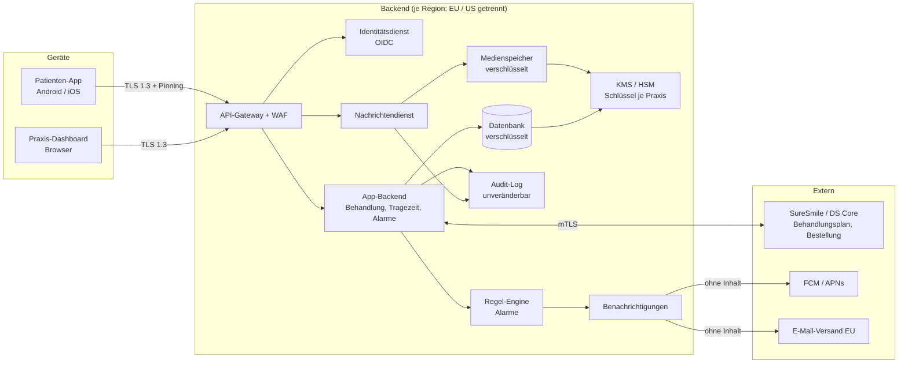
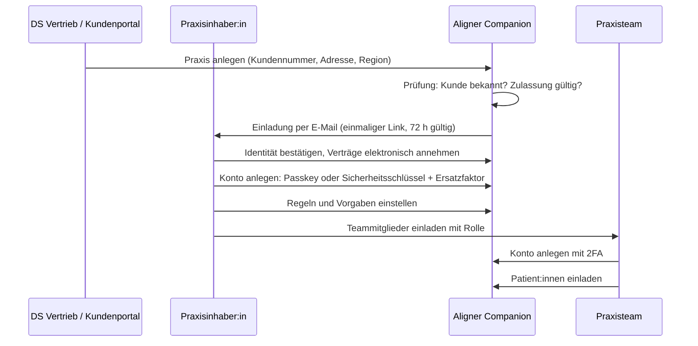

# Aligner Companion – Infrastruktur, Sicherheit und Praxis-Onboarding

**Version:** 0.1 (Entwurf) · **Stand:** 13.11.2026
**Bezug:** `SPEZIFIKATION.md` v0.2 (Kap. 6–8)

Dieses Dokument beschreibt, was für einen sicheren Betrieb nötig ist:
1. Gesamtbild der Infrastruktur
2. Sichere Kommunikation zwischen App, Praxis und Backend
3. Wie Praxen und Behandelnde ein Konto bekommen
4. Wie Patient:innen ein Konto bekommen
5. Cloud-Infrastruktur und Betrieb
6. Organisation, Verträge und Prozesse
7. Fahrplan und offene Fragen an DS-IT

---

## 1. Gesamtbild

**Grundprinzipien**
- **Kein Gesundheitsdatum verlässt den gesicherten Kanal.** Push-Nachrichten und E-Mails enthalten nur „Neue Nachricht“, nie Namen, Text oder Fotos.
- **Datenhaltung je Region:** EU-Daten bleiben in der EU, US-Daten in den USA. Dafür gibt es zwei getrennte Installationen, nicht eine gemeinsame Datenbank.
- **Mandantentrennung je Praxis:** Jede Praxis hat eigene Schlüssel. Eine Praxis kann technisch nie die Daten einer anderen sehen.
- **Dentsply-Sirona-Betrieb sieht keine Gesundheitsdaten.** Der Support arbeitet mit Metadaten. Zugriff auf Inhalte nur über ein protokolliertes Notfallverfahren (Break-Glass) mit Zustimmung der Praxis.
- **Keine Eigenbau-Kryptografie.** Nur etablierte Verfahren und Bibliotheken.

---

## 2. Sichere Kommunikation

### 2.1 Transportweg (alle Verbindungen)
| Maßnahme | Umsetzung |
|---|---|
| Verschlüsselung | TLS 1.3 (mindestens 1.2), nur starke Cipher Suites, HSTS im Dashboard |
| App → Backend | Certificate Pinning (Public-Key-Pinning mit Ersatzschlüssel), kein Klartextverkehr erlaubt (Android Network Security Config, iOS ATS) |
| Backend → SureSmile/DS Core | Gegenseitige Authentisierung (mTLS) oder OAuth2 Client Credentials mit kurzlebigen Tokens |
| Intern zwischen Diensten | mTLS im Cluster (Service Mesh), Netzwerksegmente getrennt |
| Schutz nach außen | API-Gateway mit WAF, Rate-Limiting, DDoS-Schutz des Cloud-Anbieters |

### 2.2 Verschlüsselung der Inhalte

Zwei Stufen, damit Release 1 machbar bleibt und das Zielbild trotzdem erreicht wird:

**Stufe 1 (Release 1): Verschlüsselung je Praxis auf dem Server (Envelope Encryption)**
- Jede Praxis bekommt einen eigenen Hauptschlüssel im KMS/HSM. Damit werden Datenschlüssel für Nachrichten, Fotos und Datensätze verschlüsselt.
- Fotos und Nachrichten liegen nur verschlüsselt in Datenbank und Objektspeicher.
- Entschlüsseln dürfen nur die Dienste, die eine angemeldete berechtigte Person der Praxis oder die betroffene Patient:in bedienen. Jeder Schlüsselzugriff wird im KMS protokolliert.
- Optional für große Praxisgruppen: eigener Schlüssel der Praxis (BYOK).
- Vorteil: Regel-Engine, Volltextsuche, PDF-Export und Teamzugriff funktionieren ohne Umwege.

**Stufe 2 (Zielbild): Ende-zu-Ende-Verschlüsselung für Nachrichten und Fotos**
- Protokoll **MLS (Messaging Layer Security, RFC 9420)**. Jede Unterhaltung ist eine Gruppe aus dem Gerät der Patient:in und den Geräten bzw. Browsern des berechtigten Praxisteams.
- Schlüssel entstehen auf den Geräten (Android Keystore, iOS Secure Enclave, im Browser WebCrypto mit nicht exportierbaren Schlüsseln).
- Der Server sieht nur verschlüsselte Inhalte.
- Zu lösen, bevor man umstellt: Schlüssel bei Gerätewechsel wiederherstellen, neues Teammitglied soll alte Verläufe lesen können, Übernahme in die Patientenakte, gesetzliche Aufbewahrungspflicht der Praxis.
- **Tragezeit und Alarmdaten** bleiben auch in Stufe 2 serverseitig lesbar (nur mit Stufe-1-Verschlüsselung), weil die Regel-Engine sie auswerten muss.

### 2.3 Daten auf den Geräten
| Ort | Schutz |
|---|---|
| Patienten-App | SQLCipher-Datenbank; Schlüssel im Keystore bzw. in der Secure Enclave; Fotos als verschlüsselte Dateien; nicht in Galerie und Geräte-Backup; Screenshot-Schutz; App-Sperre nach 5 min |
| Praxis-Browser | Keine Gesundheitsdaten im Browser-Speicher; Sitzung nur im Arbeitsspeicher; Sitzungsende nach 15 min Inaktivität; Download nur als protokollierter Export |

### 2.4 Benachrichtigungen und E-Mail
- **Push (FCM/APNs):** Text nur „Neue Nachricht Ihrer Praxis“. Die App holt den Inhalt danach selbst über den gesicherten Kanal.
- **E-Mail an Praxen:** über einen EU-Versanddienst mit AV-Vertrag, Absenderdomain mit SPF, DKIM und DMARC (p=reject). Inhalt: Hinweis plus Link ins Dashboard, der nur nach Anmeldung funktioniert.
- **Kein SMS-Versand von Inhalten.** SMS höchstens für Einladungscodes, falls nötig.

---

## 3. Konten für Praxen und Behandelnde

### 3.1 Ablauf

### 3.2 Schritte im Einzelnen
| Schritt | Was passiert | Wer | Nachweis |
|---|---|---|---|
| 1. Praxis registrieren | Die Praxis wird aus dem bestehenden **SureSmile-/DS-Kundenstamm** angelegt, nicht per freier Selbstregistrierung. Das verhindert Fake-Praxen. | DS Vertrieb oder Kundenportal | Kundennummer, Lieferadresse |
| 2. Zulassung prüfen | DE: Approbation bzw. Mitgliedschaft in der Zahnärztekammer (Nachweis hochladen oder Kammerverzeichnis). US: State Dental License und NPI-Abfrage. UK: GDC-Register. | DS Customer Service (Vier-Augen-Prinzip) | Prüfprotokoll im Admin-Bereich |
| 3. Verträge | Nutzungsvertrag, **AV-Vertrag nach Art. 28 DSGVO** mit TOM-Anlage, Verpflichtung nach § 203 StGB; in den USA **BAA**. Elektronisch annehmen, versioniert gespeichert. | Praxisinhaber:in | Zeitstempel, Version, Person |
| 4. Konto der Inhaber:in | Einladungslink (einmalig, 72 h). Anmeldung mit **Passkey (FIDO2)** oder Hardware-Sicherheitsschlüssel; TOTP als Ersatz. **Kein Konto ohne zweiten Faktor.** | Praxisinhaber:in | – |
| 5. Team einladen | Rollen: Behandler:in, Praxisteam, Praxis-Admin. Jede Person hat ein eigenes Konto, **keine geteilten Logins**. | Praxis-Admin | Audit-Log |
| 6. Praxis einrichten | Tragezeitziel, Pausengrenzen, Foto-Rhythmus, Alarmregeln, Standardanweisung bei Verlust, Notfallnummer, Öffnungszeiten | Praxis-Admin | Audit-Log |
| 7. Patient:innen einladen | siehe Kap. 4 | Team | Audit-Log |

### 3.3 Rollen und Rechte
| Recht | Behandler:in | Praxisteam | Praxis-Admin | DS Support |
|---|---|---|---|---|
| Patientenliste, Alarme sehen | ✓ | ✓ | ✓ | – |
| Nachrichten lesen und beantworten | ✓ | ✓ | – (konfigurierbar) | – |
| Passform bewerten, Aligner verlängern | ✓ | – | – | – |
| Ersatz bestellen | ✓ | ✓ (wenn erlaubt) | – | – |
| Regeln, Nutzer:innen, Verträge | – | – | ✓ | – |
| Technische Metadaten (Fehler, Versionen) | – | – | ✓ | ✓ |
| Inhalte (Nachrichten, Fotos) | – | – | – | **nur Break-Glass mit Freigabe der Praxis, protokolliert** |

### 3.4 Anmeldung für große Praxisgruppen
Praxisketten und DSOs wollen oft ihr eigenes Firmenkonto nutzen. Der Identitätsdienst unterstützt dafür **Single Sign-on über OIDC oder SAML** (z. B. Microsoft Entra ID). Die Pflicht zum zweiten Faktor gilt weiter; sie wird dann beim Identitätsanbieter der Gruppe geprüft.

Wenn DS bereits ein Kundenkonto hat (z. B. für **DS Core**), sollte dieses als Anmeldung wiederverwendet werden. Dann braucht die Praxis kein zusätzliches Konto.

### 3.5 Lebenszyklus der Konten
- **Austritt aus der Praxis:** Der Praxis-Admin sperrt das Konto. Alle Sitzungen und Geräte werden sofort beendet.
- **Zugriffsprüfung:** Vierteljährlich erinnert das System den Praxis-Admin, die Liste der Nutzer:innen zu bestätigen.
- **Konto-Wiederherstellung:** Nur über den Praxis-Admin oder geprüft über den DS Support, **nie allein per E-Mail-Link**.
- **Praxis kündigt:** Daten werden an die Praxis exportiert (PDF/FHIR) und nach der vereinbarten Frist gelöscht.

---

## 4. Konten für Patient:innen
| Schritt | Umsetzung |
|---|---|
| Einladung | Die Praxis erzeugt im Dashboard einen **einmaligen Code bzw. QR-Code**, gebunden an genau eine Patientenakte, 14 Tage gültig. Übergabe am Behandlungstermin oder per E-Mail. |
| Zusätzliche Prüfung | Beim Einlösen fragt die App das Geburtsdatum ab; es muss zum Eintrag der Praxis passen. Nach 5 Fehlversuchen wird der Code gesperrt. |
| Konto | E-Mail und Passwort (mindestens 12 Zeichen, Abgleich mit bekannten geleakten Passwörtern) oder Passkey; zweiter Faktor; danach Entsperren per Biometrie oder PIN. |
| Minderjährige | Je nach Markt mit Einwilligung der Eltern; Elternansicht als eigenes Konto mit begrenzter Sicht. |
| Gerätewechsel | Neue Anmeldung mit zweitem Faktor. Das alte Gerät wird abgemeldet. |
| Ende der Behandlung | Die App wechselt in die Retainer-Phase oder das Konto wird nach Frist gelöscht. Die Praxisakte bleibt bei der Praxis. |

---

## 5. Cloud-Infrastruktur und Betrieb

### 5.1 Hosting
| Punkt | Anforderung |
|---|---|
| Anbieter | Cloud-Standard von DS (z. B. Azure, AWS oder GCP) mit **BSI-C5-Testat**, ISO 27001, SOC 2; für die USA mit unterschriebenem BAA |
| Regionen | EU: Deutschland (z. B. Frankfurt) mit zweiter Zone für Ausfallsicherheit. US: eigene Installation. Keine Datenübertragung zwischen den Regionen. |
| Umgebungen | Entwicklung, Test, Abnahme, Produktion strikt getrennt. **Keine echten Patientendaten außerhalb der Produktion.** |
| Laufzeit | Container (z. B. Kubernetes oder Managed Container Service), automatisch skaliert, unveränderbare Images |
| Datenbank | Managed PostgreSQL, verschlüsselt (Schlüssel im KMS), Zugriff nur aus dem privaten Netz, Point-in-Time-Recovery |
| Medien | Objektspeicher mit serverseitiger Verschlüsselung über KMS, kein öffentlicher Zugriff, Download nur über kurzlebige signierte URLs |
| Schlüssel | KMS mit HSM-Schutz (FIPS 140-2/3 Level 3), Schlüssel je Praxis, automatische Rotation, Zugriff protokolliert |
| Geheimnisse | Secrets Manager; keine Passwörter oder Schlüssel im Code oder in Konfigurationsdateien |

### 5.2 Verfügbarkeit und Datensicherung
| Kennzahl | Ziel |
|---|---|
| Verfügbarkeit | ≥ 99,5 % |
| RPO (maximaler Datenverlust) | ≤ 15 min |
| RTO (maximale Ausfallzeit) | ≤ 4 h |
| Backups | Täglich plus fortlaufend, verschlüsselt, getrennt vom Produktionskonto, in derselben Region; Wiederherstellung vierteljährlich testen |

### 5.3 Überwachung und Sicherheit im Betrieb
- Zentrales Logging **ohne Gesundheitsdaten** (automatischer Filter und Tests), angebunden an ein SIEM.
- Alarme bei Auffälligkeiten: viele fehlgeschlagene Anmeldungen, ungewöhnliche Exporte, Schlüsselzugriffe außerhalb der Dienste.
- Fehlerberichte der App über einen EU-gehosteten Dienst oder selbst betrieben (z. B. Sentry), ohne Gesundheitsdaten.
- Laufende Schwachstellenscans für Container und Abhängigkeiten; Patches nach festgelegten Fristen (kritisch ≤ 7 Tage).
- Penetrationstest vor dem Start und jährlich (App nach OWASP MASVS L2, Backend und Dashboard nach OWASP ASVS, Prüfung nach BSI TR-03161).
- Öffentlicher Meldeweg für Sicherheitslücken (security.txt, Vulnerability Disclosure Policy).

### 5.4 Softwarelieferung
- CI/CD mit Pflicht-Code-Review, statischer Analyse (SAST), Prüfung der Abhängigkeiten, SBOM je Release.
- Signierte Builds; Signaturschlüssel der Apps im HSM bzw. über Play App Signing und Apple-Zertifikate in einem geschützten Konto.
- Freigabe nach IEC 62304: Release-Notizen, Prüfnachweise, Risikobewertung.
- Store-Konten (Google Play, Apple) auf Dentsply Sirona als Firma, mit 2FA und mindestens zwei Verantwortlichen.

### 5.5 Externe Dienste (jeweils mit AV-Vertrag bzw. BAA)
| Dienst | Zweck | Gesundheitsdaten? |
|---|---|---|
| Cloud-Anbieter | Hosting, KMS | ja (verschlüsselt) |
| Firebase Cloud Messaging, Apple Push | Push-Hinweise | nein |
| E-Mail-Versand (EU) | Einladungen, Hinweise | nein |
| Fehlerberichte | Absturzanalyse | nein (gefiltert) |
| Analyse (nur mit Einwilligung) | Nutzungsstatistik | nein |
| SureSmile / DS Core | Behandlungsplan, Bestellungen | ja (intern, DS) |

---

## 6. Organisation, Verträge und Prozesse
| Thema | Was gebraucht wird | Verantwortlich |
|---|---|---|
| Rollen nach DSGVO | Praxis = Verantwortliche, DS = Auftragsverarbeiter (bestätigen) | Legal / Datenschutz |
| Verträge mit Praxen | Nutzungsvertrag, AV-Vertrag mit TOM-Anlage, § 203-Verpflichtung, BAA (USA) | Legal |
| Datenschutz-Folgenabschätzung | vor dem Start, bei größeren Änderungen aktualisieren | Datenschutzbeauftragte:r |
| ISMS | Produkt in den ISO-27001-Geltungsbereich von DS aufnehmen | IT Security |
| Medizinprodukt | Zweckbestimmung, Einstufung (B1/B2), QMS nach ISO 13485, IEC 62304 | Regulatory Affairs / QM |
| Vorfälle | Notfallplan: Erkennen, Eindämmen, Meldung an Behörde binnen 72 h, Information der Praxen | IT Security + Datenschutz |
| Support | Support-Modell ohne Zugriff auf Inhalte; Break-Glass-Verfahren mit Freigabe und Protokoll | Customer Service |
| Schulung | Kurze Einweisung für Praxen (Rollen, 2FA, Umgang mit Exporten) | Customer Success |

---

## 7. Fahrplan und offene Fragen

### 7.1 Reihenfolge des Aufbaus
1. **Grundlagen klären:** Cloud-Anbieter und Region, Anbindung an DS-Identität bzw. DS Core, Rollen nach DSGVO, Threat Model.
2. **Landing Zone aufbauen:** Konten bzw. Subscriptions je Umgebung, Netzwerk, KMS, Logging, CI/CD.
3. **Identitätsdienst:** Praxis- und Patientenkonten, 2FA, Rollen, Einladungen.
4. **Kerndienste:** Behandlung, Tragezeit, Nachrichten (Stufe 1), Medien, Regel-Engine, Audit-Log.
5. **Integrationen:** SureSmile-Planimport, Push, E-Mail.
6. **Absicherung:** Penetrationstest, DSFA abschließen, Notfallübung, Wiederherstellungstest.
7. **Pilot** mit 2–3 Praxen in einer Region.
8. **Stufe 2:** Ende-zu-Ende-Verschlüsselung (MLS) für Nachrichten und Fotos.

### 7.2 Offene Fragen an DS-IT und Fachbereiche
- Welche Cloud und welche Landing Zone sind bei DS Standard? Gibt es bereits C5- bzw. HIPAA-fähige Umgebungen (z. B. für DS Core)?
- Gibt es ein zentrales Kundenkonto bzw. einen Identitätsdienst (DS Core, Kundenportal), den Praxen schon nutzen?
- Welche Schnittstellen bietet SureSmile für Behandlungsplan und Bestellung?
- Wie läuft heute die Prüfung der Zulassung bei SureSmile-Kunden, und lässt sie sich wiederverwenden?
- Welche DS-Gesellschaft ist Vertragspartner und Auftragsverarbeiter je Markt?
- Welche Aufbewahrungsfristen gelten für Nachrichten und Fotos (Praxis: in DE 10 Jahre Dokumentationspflicht) – bleibt die Kopie in der App oder nur in der Praxisakte?
